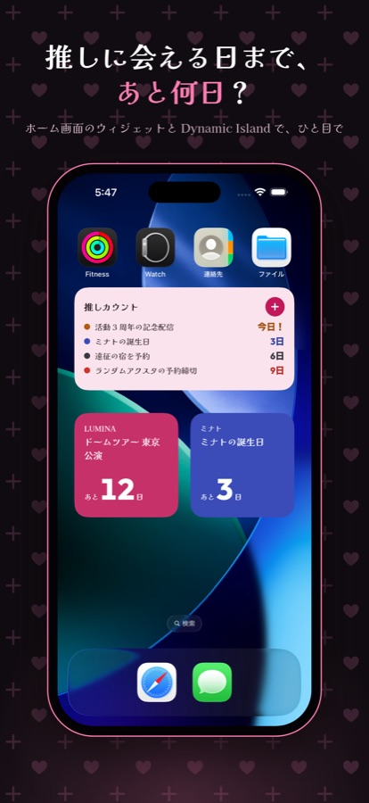
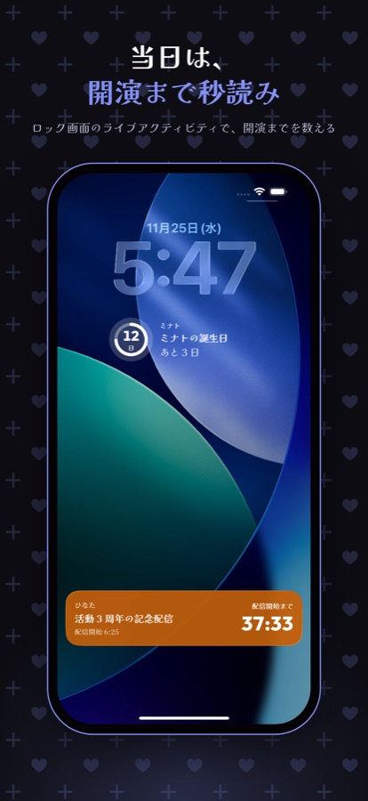
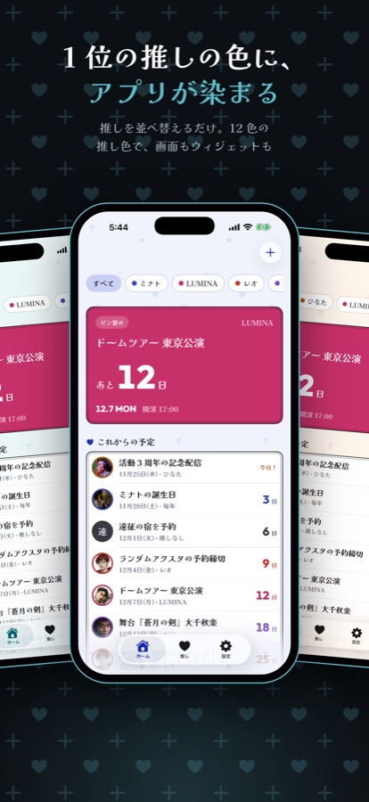
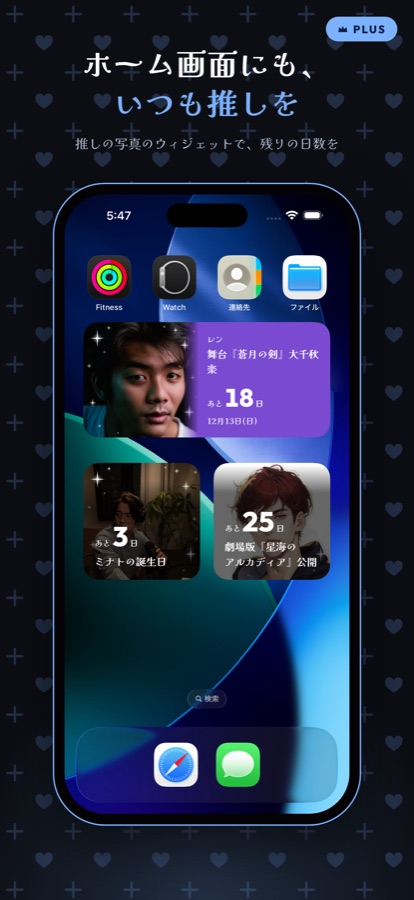
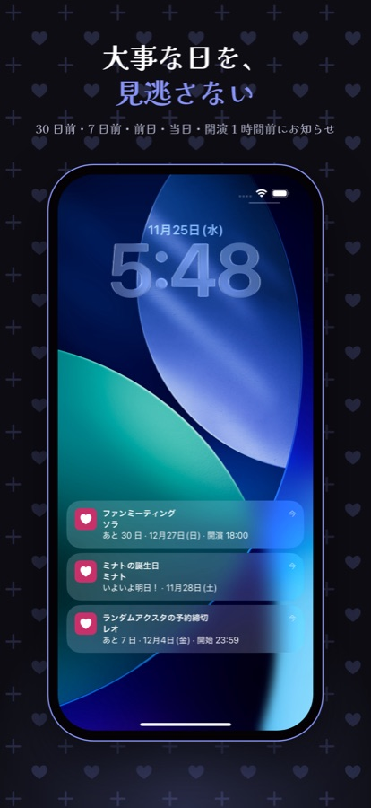

# 推し活カウントダウン（OshiCon）

推しのライブ・誕生日・発売日・配信まで「あと何日」を数える、推し活のためのカウントダウンアプリの iOS 版です（iPhone・iPad。iOS 17 以上）。

  
  
  
  
  

- **推し色のカウントダウン**: 推しと推し色を登録すると、予定とカウントダウンが推し色になり、いちばん上の推しの色でアプリとウィジェットが染まる
- **ウィジェット・ライブアクティビティ・通知**: ホーム画面とロック画面のウィジェット、当日の開演までの秒読み（ロック画面と Dynamic Island）、予定の前の通知
- **画像でシェア**: 「あと○日」を、推しの写真と推し色のカードの画像にして共有
- **推し活カウントダウン Plus（有料）**: 推しの写真のウィジェットと、背景・飾りの着せ替え
- 広告なし・データは端末の中だけ（通信しない）。12 言語に対応

## Status

  <table width="98%" style="border-collapse: collapse;border:2px double #000080;text-align:center;margin:auto;">
    <tbody>
      <tr>
        <td style="border:2px double #000080;">branch \ workflow</td>
        <td style="border:2px double #000080;">Build</td>
        <td style="border:2px double #000080;">Upload</td>
      </tr>
      <tr>
        <td style="border:2px double #000080;text-align:left;">main</td>
        <td style="border:2px double #000080;text-align:center;">
          
        </td>
        <td style="border:2px double #000080;text-align:center;">
        </td>
      </tr>
      <tr>
        <td style="border:2px double #000080;text-align:left;">develop</td>
        <td style="border:2px double #000080;text-align:center;">
          
        </td>
        <td style="border:2px double #000080;text-align:center;">
          
        </td>
      </tr>
    </tbody>
  </table>

## ドキュメント

### 開発

- [開発ガイド](docs/development.md): 開発環境・仕様の扱い・多言語対応・リポジトリの構成
- [初期設定](docs/setup.md): 署名・GitHub Secrets・App Store Connect のアプリの作成
- [ブランチ運用と CI](docs/ci.md): どのブランチで、どのワークフローがいつ動くか
- [PR 本文のスクリーンショット](docs/pr-screenshots.md): Before / After の画像の添付のしかた
- [仕様](docs/spec/README.md): 仕様リポジトリ [shariverse/app-specs](https://github.com/shariverse/app-specs) から生成した iOS 版の仕様（直接編集しない）

### 機能

- [テーマ](docs/design/themes.md): 地雷系・ゴシックの配色・書体・装飾と、1 位の推しの推し色で染めるテーマカラー
- [ウィジェット](docs/widgets.md): ホーム画面・ロック画面のウィジェット 3 種と、推しの写真のウィジェットの Plus の判定
- [推しの写真の調整](docs/photo-crop.md): 拡大・縮小・移動・回転して丸の範囲を決める
- [画像でシェア](docs/share-card.md): 予定の「あと○日」を正方形のカードの画像にして渡す
- [着せ替え（Plus）](docs/appearance.md): 背景の写真と推しの写真の飾り

### App Store

- [App Store 用スクリーンショット](docs/app-store/screenshots/README.md): 撮り方・見出し・README の画像の作り方
- [掲載文とスクリーンショットの登録](docs/app-store/metadata-workflow.md): ワークフロー「App Store Metadata」
- [課金の商品の登録](docs/app-store/in-app-purchases.md): ワークフロー「App Store In-App Purchases」と、手元での課金の確かめ方
- [App Store 公開用の文面](docs/app-store/README.md): 掲載文・プライバシーポリシー・審査用メモなどの下書き

## License

[MIT License](LICENSE)
